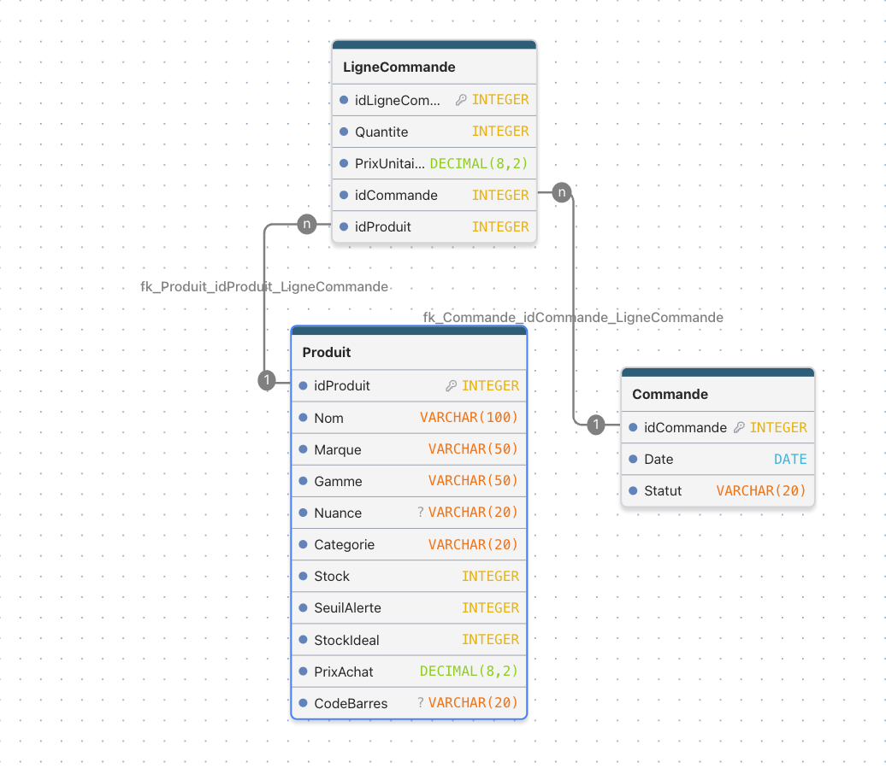

# gestion-stock-salon

Gestion de stock d'un salon de coiffure

Application web de gestion du stock pour un salon de coiffure indépendant,
développée bénévolement en collaboration avec la gérante.

> Le code n'est pas encore publié. Ce dépôt documente l'avancement du projet.

## Contexte

La gérante note aujourd'hui à la main ce qui manque pour passer commande.
L'objectif : faire l'inventaire hebdomadaire rapidement, préparer les
commandes fournisseur et suivre les dépenses pour la fiduciaire.

## Fonctionnalités prévues

- **V1 – Inventaire** : catalogue de produits, stock avec boutons +/−, alertes de stock bas
- **V2 – Commandes** : commande proposée à partir des produits sous le seuil, historique
- **V3 – Dépenses** : totaux par mois / trimestre / année, export pour la fiduciaire
- **V4 – Scan** : recherche d'un produit par code-barres avec la caméra

## Technologies

- Front : React + TypeScript
- API : ASP.NET Core (C#)
- Base de données : SQLite en développement

## Modèle de données

Schéma détaillé : [docs/schema.dbml](docs/schema.dbml)

Le prix d'achat est recopié sur chaque ligne de commande, pour que
l'historique reste juste même si le fournisseur change ses tarifs.

## Avancement

- [x] Cahier des charges rédigé avec la gérante
- [x] Modèle de données (MLD)
- [ ] MCD
- [ ] API : produits
- [ ] Front : inventaire (V1)

## Journal

- **Octobre 2026** : cahier des charges validé, modèle de données terminé.
